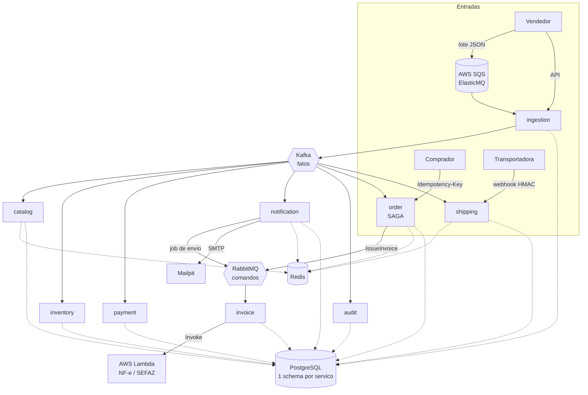

# Mini Marketplace (v3)

Mini Mercado Livre em **microsservicos Java 21 / Spring Boot 3.5**: o vendedor publica itens e
estoque por **AWS SQS**, o comprador compra, a **SAGA** reserva estoque e autoriza o pagamento, a
**NF-e** e emitida por uma **AWS Lambda**, a transportadora atualiza o rastreio por **webhook
assinado**, vendedor e comprador recebem **e-mails**, e um servico de **auditoria** liga tudo de
ponta a ponta. Kafka, RabbitMQ, Redis e PostgreSQL, cada um no papel em que e melhor.

> **Perfil de execucao: A (Docker).** Tudo sobe com um comando e foi testado ponta a ponta
> (`python e2e/tdd.py all --chaos`): **284 testes unitarios + 27 testes E2E** (23 de fluxo e 4 de caos).

---

## Como rodar

Requisitos: **Docker** (Docker Desktop no Windows) e **Python 3.10+**. Java 21/Maven sao opcionais
(sem eles o build roda dentro de um container).

```bash
python e2e/tdd.py all            # testes unitarios -> build -> sobe tudo -> testes E2E
python e2e/tdd.py all --chaos    # idem + derruba servicos para provar a resiliencia
python e2e/tdd.py status         # saude dos 9 servicos
python e2e/tdd.py down           # para (python e2e/tdd.py clean apaga o banco)
```

| O que | Onde |
|---|---|
| Pedidos (comprador) | http://localhost:8080/orders |
| Rastreio | http://localhost:8085/shipments/{orderId} |
| Auditoria ponta a ponta | http://localhost:8088/audit/orders/{orderId} |
| E-mails enviados (Mailpit) | http://localhost:8025 |
| RabbitMQ | http://localhost:15672 (marketplace / marketplace) |
| Banco (um so) | `localhost:5432/marketplace` (usuario `observer` / `observer` le todos os schemas) |
| Kafka UI (opcional) | `docker compose --profile tools up -d kafka-ui` -> http://localhost:8090 |

---

## Arquitetura



| Servico | Porta | Responsabilidade | Usa |
|---|---|---|---|
| ingestion | 8086 | Recebe lotes do vendedor (SQS ou API), valida item a item, idempotente por lote | SQS, Kafka |
| catalog | 8081 | Itens e precos; cache-aside | Kafka, Redis |
| inventory | 8082 | Estoque, reserva tudo-ou-nada, baixa, liberacao, reposicao por devolucao | Kafka |
| order | 8080 | API do comprador, orquestrador da SAGA e do pos-venda | Kafka, RabbitMQ, Redis |
| payment | 8083 | Autoriza, captura, estorna; timeout = estado desconhecido + reconciliacao; ledger | Kafka |
| invoice | 8084 | NF-e por vendedor via Lambda; rejeicao fiscal x falha tecnica | RabbitMQ, Lambda, Kafka |
| shipping | 8085 | Uma etiqueta por vendedor, webhooks da transportadora, rastreio | Kafka, Redis |
| notification | 8087 | E-mail para vendedor e comprador, sem duplicar | Kafka, RabbitMQ, Redis, SMTP |
| audit | 8088 | Trilha imutavel de todos os fatos; linha do tempo ponta a ponta | Kafka |

Cada servico e uma **unidade independente** (proprio `pom.xml`, `Dockerfile`, schema e usuario no
banco, migrations Flyway) e segue **arquitetura hexagonal / Clean Architecture**, travada por ArchUnit
(12 regras por servico) e Maven Enforcer (servico nao depende de servico). Decisoes: `docs/adr/`;
contratos de eventos e REST: `docs/contracts/`.

```
services/order-service/
  Dockerfile  pom.xml
  src/main/resources/            application.yml, db/migration/ (Flyway)
  src/main/java/br/com/marketplace/order/
    domain/                      entidades, value objects, regras de negocio (Java puro)
    application/
      port/in/                   casos de uso expostos (PlaceOrderUseCase, ...)
      port/out/                  o que o caso de uso precisa (OrderRepository, RateLimiter, ...)
      service/                   implementacao dos casos de uso
    adapter/
      in/web/                    controllers REST e DTOs
      in/messaging/              listeners Kafka / RabbitMQ / SQS
      in/scheduler/              jobs agendados
      out/persistence/           repositorios JDBC (SQL fica so aqui)
      out/cache/                 Redis
    config/                      beans e configuracao Spring
```

### Papel de cada tecnologia (ADR-0010)

- **PostgreSQL**: fonte da verdade. Um banco, **um schema e um usuario por servico** (um nao enxerga o
  outro). Invariantes no banco: `CHECK reserved <= on_hand`, `UNIQUE(order_id, seller_id)`, ledger e
  auditoria com trigger que proibe UPDATE/DELETE.
- **Kafka**: fatos de negocio e passos da SAGA (historico, varios consumidores, replay, auditoria).
- **RabbitMQ**: comandos e jobs com retry (emitir NF-e, enviar e-mail): filas quorum, retry com TTL e
  jitter, fila `.parking` quando esgota.
- **Redis**: cache do catalogo e do rastreio, rate limit do checkout, trava contra e-mail duplicado.
  Nunca e a unica copia: Redis fora = sistema mais lento, nao quebrado.
- **SQS / Lambda (AWS)**: entrada assincrona do vendedor e emissao da NF-e, com o **AWS SDK oficial**.
  Localmente: ElasticMQ (API SQS) e a imagem oficial `public.ecr.aws/lambda/java:21` (Runtime
  Interface Emulator). Na AWS so muda o endpoint (ADR-0011).
- **Threads**: consumidores Kafka/Rabbit com concorrencia limitada por fila/particao; virtual threads
  so para I/O externo (gateway, Lambda, poller SQS) com bulkhead e timeout (ADR-0014).

---

## Tratativas (o que pode dar errado e o que o sistema faz)

| Problema | Tratativa | Provado em |
|---|---|---|
| Comprou mais do que tinha | Reserva tudo-ou-nada; cancela, nao cobra, e-mail explicando | `test_buying_more_than_stock...` |
| Dois compradores, uma unidade | Lock ordenado + CHECK no banco: 8 compras simultaneas, 1 vence | `test_race_for_the_last_unit...` |
| Clique duplo / retry do app | Idempotency-Key + hash do corpo (mesma chave, outro corpo = 422) | `test_same_idempotency_key...` |
| Mensagem duplicada (at-least-once) | Inbox por consumidor + chaves de negocio UNIQUE | unitarios + E2E |
| Lote do vendedor repetido / fora de ordem | Idempotencia por lote; `sequence` por SKU | `test_resent_batch...`, `test_out_of_order...` |
| Lote invalido | Item ruim rejeitado com motivo; lote quebrado vai para a DLQ do SQS | `test_invalid_items...`, `test_broken_batch...` |
| Pagamento recusado | Compensacao: libera reserva | `test_declined_payment...` |
| Gateway sem resposta (timeout) | Estado DESCONHECIDO, nunca recusado; reconciliacao com a mesma chave | `test_gateway_timeout...` |
| Aprovacao chega depois do cancelamento | Estorno automatico (VOID) | unitario `SagaCoordinatorTest` |
| Gateway instavel | Timeout + bulkhead + circuit breaker | `ResilientPaymentGateway` |
| NF-e rejeitada (cadastro irregular) | Pedido ON_HOLD, nao captura, nao gera etiqueta, vendedor avisado | `test_rejected_invoice...` |
| SEFAZ/Lambda fora do ar | Retry com backoff no RabbitMQ; volta e emite | `test_lambda_down...` (caos) |
| Etiqueta/envio duplicado | `UNIQUE(order_id, seller_id)`; evento repetido nao gera outra | `test_duplicate_invoice_event...` |
| Webhook falsificado ou reenviado | HMAC sobre o corpo bruto, anti-replay (5 min), dedupe por eventId | `test_webhook_with_bad_signature...` |
| Evento de envio fora de ordem | Maquina de estados ignora e guarda para auditoria | `test_out_of_order_carrier_event...` |
| Extravio | Estorno da parte do vendedor | `test_lost_shipment...` |
| Devolucao ao remetente | Estorno + reposicao de estoque | `test_returned_shipment...` |
| Servico fora do ar | Mensagens esperam no broker; o resto segue | `test_05_resilience.py` (caos) |
| Rajada de pedidos (bot) | Rate limit no Redis (429), fail-open | `test_burst_from_same_buyer...` |

---

## Rastreabilidade ponta a ponta

Todo envelope carrega `correlationId` (orderId na compra, batchId no vendedor) e `causationId`
(a mensagem que causou esta). Todo log e JSON com esses campos (MDC).

- **Negocio**: `GET /audit/orders/{orderId}` devolve a linha do tempo do pedido **e** o lado do
  vendedor (lote que publicou cada SKU), com topico/particao/offset de cada fato.
- **Tecnico**: `docker compose -f docker-compose.yml -f docker-compose.datadog.yml up -d` com
  `DD_API_KEY`: no Datadog, busque `@correlationId:<orderId>` e veja o pedido em todos os servicos.

---

## Testes (TDD)

| Nivel | Quantidade | O que garante | Comando |
|---|---|---|---|
| Unitario (dominio e casos de uso) | 284 | regras puras, idempotencia, politicas de retry, assinatura | `python e2e/tdd.py unit` |
| Arquitetura | 12 regras x 9 servicos | hexagonal: dominio puro, adaptadores so chamam portas, SQL/Kafka/Rabbit/AWS so em adapter | (junto do unit) |
| Contrato x spec (SDD) | 4 | topicos = AsyncAPI = script de criacao = filas | (junto do unit) |
| E2E | 23 | fluxos reais via SQS, HTTP, webhooks, e-mail, auditoria | `python e2e/tdd.py e2e` |
| Caos | 4 | servico/Redis/Lambda fora e o resto continua | `python e2e/tdd.py chaos` |

---

## Estrutura do repositorio

```
services/*                  9 microsservicos (hexagonal), cada um com pom, Dockerfile e migrations
libs/event-contracts        envelope, topicos, filas, payloads (sem logica)
libs/messaging-support      outbox (Kafka+Rabbit), inbox, relay, DLT com jitter, retry/parking, LogContext
libs/architecture-rules     regras ArchUnit compartilhadas
lambdas/nfe-emitter-lambda  Lambda Java (CNPJ, chave de acesso mod 11, rejeicoes SEFAZ)
infra/                      postgres (schemas), kafka (topicos), rabbitmq (filas), elasticmq (SQS)
e2e/                        suite pytest (vendedor, comprador, transportadora, auditoria, caos) e runner tdd.py
docs/adr/                   decisoes de arquitetura
docs/contracts/             AsyncAPI, OpenAPI e filas RabbitMQ
```

## Limites conhecidos e evolucao

- Gateway de pagamento e transportadora sao simulados (mesmos contratos de idempotencia e webhook dos reais).
- Um broker Kafka/RabbitMQ e um Postgres (local). Producao: 3 brokers, quorum de 3, Postgres por servico com replica.
- Outbox por polling (200 ms). Em volume alto: CDC (Debezium) e particionamento da tabela.
- Sem autenticacao de usuario final (JWT/API gateway documentados como proxima etapa).
- Filtro de estoque no Redis (Lua DECR) para promocoes relampago: desenhado, nao implementado.

## Uso de IA

Este projeto foi construido com apoio de IA (Claude) para gerar codigo, testes e documentacao.
A autora revisou as decisoes de arquitetura, conferiu os fluxos rodando o ambiente e a suite de
testes, e responde pelo conteudo apresentado.
